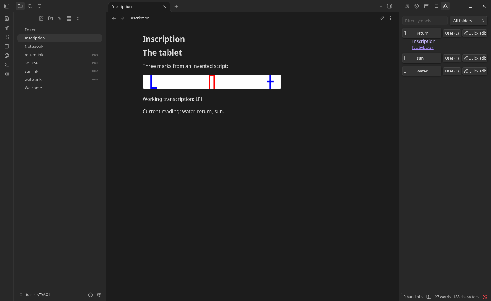
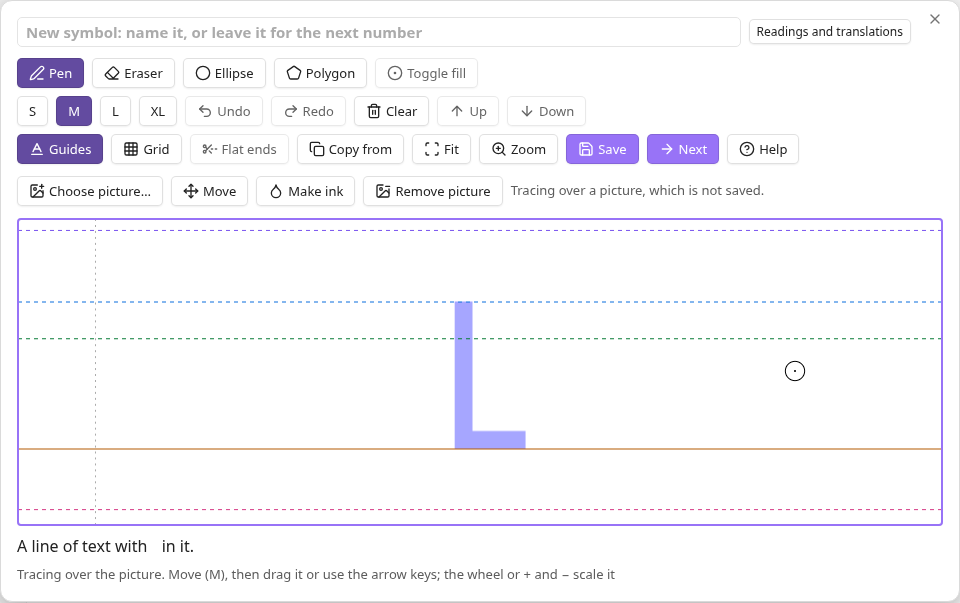

# Inkline

An Obsidian plugin for symbols that no font has: draw one once, then write it in
your notes as easily as a letter, as often as it comes up. Each symbol sits
inside the line of text like a character, by default at the text's size and in
its color.

## Install

Inkline runs in Obsidian 1.13.4 or later on desktop. 1.0.0 is its first stable
release, and its file format is frozen: symbols saved by 0.9.2 or later open as
they are, and every symbol saved from now on keeps opening and looking the same.
A symbol saved by a version before 0.9.2 opens as a picture to draw over,
without its strokes.

1. In Obsidian, open **Settings → Community plugins**, turn community plugins on
   if needed, and select **Browse**.
2. Search for **Inkline**, select it, then select **Install** and **Enable**.

If Inkline does not show there yet, install the ZIP from the latest release:

1. Download the install ZIP, `inkline-<version>.zip`, from the assets of the
   release marked **Latest** on
   [GitHub releases](https://github.com/viell-dev/slop-inkline/releases): the
   newest public release, such as 1.0.0.
2. Extract it into your vault's `.obsidian/plugins/` directory. The ZIP holds
   its own `inkline/` folder, so the plugin's three files end up in
   `.obsidian/plugins/inkline/`.
3. In Obsidian, open **Settings → Community plugins**, turn community plugins on
   if needed, and enable **Inkline**.

Once Inkline shows in Obsidian's community plugins, Obsidian offers its updates,
however you installed it; until then, update a ZIP installation by hand. The
[installation guide](https://viell-dev.github.io/slop-inkline/install) covers
updates, pre-releases, older versions, and installing with BRAT. Release notes
describe compatibility changes.

A public release has an even minor version, as 1.0.0, and a pre-release an odd
one, as 1.1.0, for trying changes before the next public release. Obsidian's
community plugins offer public releases only. Every release, public or not,
stays on GitHub with its install ZIP.

## Your first symbol

1. In a note, put the cursor where the symbol goes, and run **Inkline: Insert
   symbol** from the command palette (Ctrl+P, or Cmd+P on macOS).
2. Draw the symbol with a mouse or a trackpad. The lines across the drawing area
   are guides at the text font's lines.
3. Type a name, such as `tower`, in the field at the top, and press **Save**, or
   Ctrl+Enter (Cmd+Enter on macOS). Inkline saves it as `tower.ink.png` and puts
   its embed, `![[tower.ink.png]]`, where the cursor was. The note shows it in
   the line, like a character.
4. To use it again, type the insert trigger and the first letters of its name in
   any note, as `;;tow` with the default trigger, and press Enter.

[Your first symbol](https://viell-dev.github.io/slop-inkline/start) in the guide
goes on from there, and
[Saving and recovery](https://viell-dev.github.io/slop-inkline/recovery) says
how to get unsaved work back.

## What it is for

Inkline is for writing notes in a script that no font has, so you cannot type
it. That is the same work from two directions:

- **Working a script out.** Some games are built around an invented language,
  and working it out is the game. You draw the symbols that someone else made.
- **Making a script up.** A constructed language (a conlang) can have a script
  of its own. You draw the symbols that you make.

Either way, Inkline does two things:

- **Write a symbol down easily.** Draw it where you need it, or trace it from a
  picture, and it sits in the line like a letter.
- **Use it again easily.** A symbol has a name, and can record how it is read
  and what it means. Type the insert trigger, `;;` unless you change it in the
  settings, and a few letters of any of them to write the symbol again in any
  note. Its readings and translations can be edited at any time without changing
  a note, and the library finds every note that uses it.

A cipher or a personal shorthand works the same way.

Each symbol is a normal PNG file in your vault, embedded with a normal image
link, so your notes still show it if you disable or uninstall the plugin.

Paste a picture to trace, then turn each sign into ink with **Make ink** and
**Next**, or draw over it yourself:

## Documentation

The [user guide](https://viell-dev.github.io/slop-inkline/) covers installing
the release ZIP, drawing and inserting symbols, saving and recovery, the
keyboard, known limits, and reporting a problem. It describes the latest
release, prereleases included.

## Contributing

Inkline is written and maintained by AI agents, and no person reviews the code.
[CONTRIBUTING.md](CONTRIBUTING.md) explains reporting problems, requesting
features, development setup, checks, and pull requests. [AGENTS.md](AGENTS.md)
adds the agents' maintenance and review rules; [RELEASING.md](RELEASING.md)
describes publication and its gates. Planned work and decisions live in the
[issues](https://github.com/viell-dev/slop-inkline/issues).

## For theme, plugin, and tool authors

[docs/rendering.md](docs/rendering.md) describes the classes and properties
Inkline gives symbols in text, and how a plugin's own view of a note can show
them as text. [docs/file-format.md](docs/file-format.md) specifies what a symbol
file holds, for tools that read or write them.

## License

[MIT](LICENSE). The outline of a stroke is adapted from
[perfect-freehand](https://github.com/steveruizok/perfect-freehand), copyright
2021 Stephen Ruiz Ltd, under the MIT licence; its notice is in
[src/ink/freehand.LICENSE.txt](src/ink/freehand.LICENSE.txt) and at the top of
the plugin's `main.js`.
