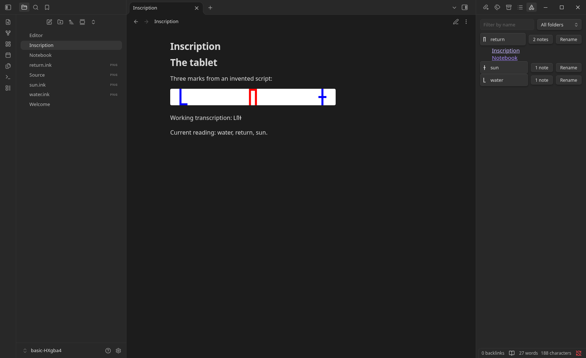

# Inkline

An Obsidian plugin for drawing symbols that no font has, so that you can write
them in your notes as easily as letters. Each symbol sits inside the line of
text like a character, at the text's size and in its color.

It is made for working out invented scripts, such as the languages of puzzle
games like Chants of Sennaar: draw a symbol where you meet it, name it with your
current guess at its meaning, rename it as your reading changes, and find every
note that uses it. Conlang glyphs, ciphers, game marks, and personal shorthand
work the same way.

Each symbol is a normal PNG file in your vault, embedded with a normal image
link, so your notes still show it if you disable or uninstall the plugin.

Paste a picture to trace, then turn each sign into ink with **Make ink** and
**Next**, or draw over it yourself:

## Documentation

The [user guide](https://viell-dev.github.io/slop-inkline/) covers installing
with BRAT, drawing and inserting symbols, saving and recovery, the keyboard,
known limits, and reporting a problem. It describes the latest release,
prereleases included.

## Status

Version 0.1.0 is a prerelease for Obsidian 1.13.4 or later on desktop. Install
with [BRAT](https://github.com/TfTHacker/obsidian42-brat), adding the repository
`viell-dev/slop-inkline`; see the
[installation guide](https://viell-dev.github.io/slop-inkline/install). The
planned work is in the
[issues](https://github.com/viell-dev/slop-inkline/issues). This repository is a
rewrite of an earlier prototype; the rewrite changes the file format, the
editor, and how symbols are rendered, and keeps the prototype's files readable.

Inkline is written and maintained by AI agents, and no person reviews the code.
Changes are accepted on their unit tests, on end-to-end tests that run the
plugin in real Obsidian builds, and on review by the agent that wrote them, with
an independent review by another agent for releases, for changes that could lose
or damage a drawing, such as to the file format or saving, and for changes to
the checks and release steps that guard them. [AGENTS.md](AGENTS.md) holds the
agents' rules for this repository, and [CONTRIBUTING.md](CONTRIBUTING.md)
explains how to report a problem or contribute.

## For theme, plugin, and tool authors

[docs/rendering.md](docs/rendering.md) describes the classes and properties
Inkline gives symbols in text, and how a plugin's own view of a note can show
them as text. [docs/file-format.md](docs/file-format.md) specifies what a symbol
file holds, for tools that read or write them.

## License

[MIT](LICENSE)
