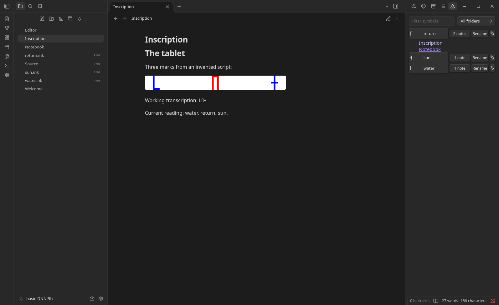
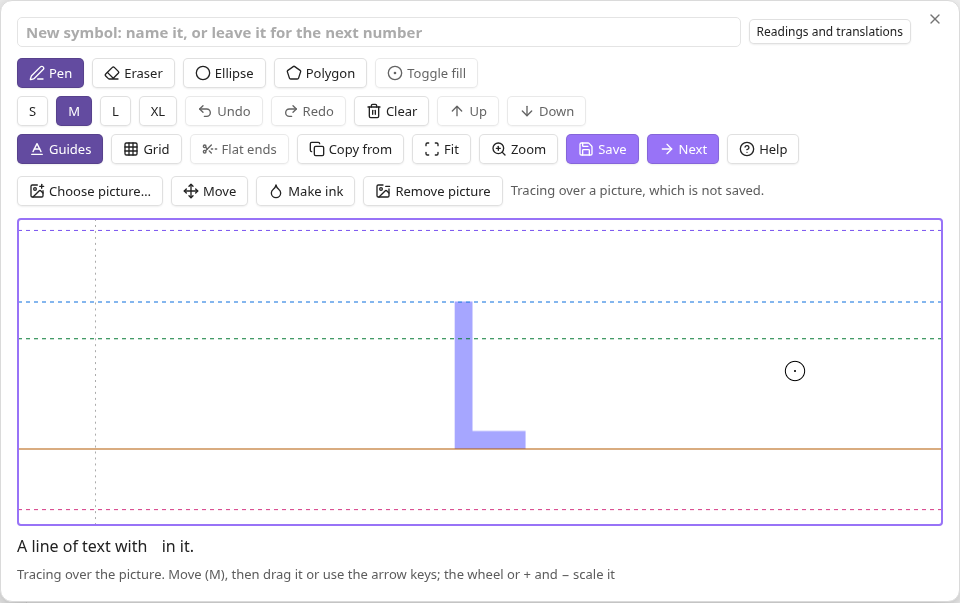

# Inkline

An Obsidian plugin for symbols that no font has: draw one once, then write it in
your notes as easily as a letter, as often as it comes up. Each symbol sits
inside the line of text like a character, at the text's size and in its color.

## Install

Inkline is a prerelease for Obsidian 1.13.4 or later on desktop. The 0.9
releases lead to the first stable release, 1.0.0: from 0.9.2 on they are its
release candidates, and the file format is final. A symbol saved by an earlier
version opens as a picture to draw over, without its strokes.

1. Download the install ZIP, `inkline-<version>.zip` of the highest version,
   from the release's assets on
   [GitHub releases](https://github.com/viell-dev/slop-inkline/releases).
2. Extract it into your vault's `.obsidian/plugins/` directory. The ZIP holds
   its own `inkline/` folder, so the plugin's three files end up in
   `.obsidian/plugins/inkline/`.
3. In Obsidian, open **Settings → Community plugins**, turn community plugins on
   if needed, and enable **Inkline**.

The [installation guide](https://viell-dev.github.io/slop-inkline/install)
covers updates, older versions, and installing with BRAT. Release notes describe
compatibility changes.

Inkline is not in Obsidian's community plugin directory yet. The plan is that
1.0.0 is its first release there, and that the directory offers public releases
only. Every release, public or not, stays on GitHub with its install ZIP.

## Your first symbol

1. In a note, put the cursor where the symbol goes, and run **Inkline: Insert
   symbol** from the command palette (Ctrl+P, or Cmd+P on macOS).
2. Draw the symbol with a mouse or a trackpad. The lines across the drawing area
   are guides at the text font's lines.
3. Type a name, such as `tower`, in the field at the top, and press **Save**, or
   Ctrl+Enter (Cmd+Enter on macOS). Inkline saves it as `tower.ink.png` and puts
   its embed, `![[tower.ink.png]]`, where the cursor was. The note shows it in
   the line, like a character.
4. To use it again, type `;;tow` in any note, and press Enter.

[Your first symbol](https://viell-dev.github.io/slop-inkline/start) in the guide
goes on from there, and
[Saving and recovery](https://viell-dev.github.io/slop-inkline/recovery) says
how to get unsaved work back.

## What it is for

Inkline is for writing notes in a script that no font has, so that you cannot
type it. That is the same work from two directions:

- **Working a script out.** Some games, such as Chants of Sennaar, have an
  invented language, and working it out is the game. You draw the symbols that
  someone else made.
- **Making a script up.** A constructed language (a conlang) can have a script
  of its own. You draw the symbols that you make.

Either way, Inkline does two things:

- **Write a symbol down easily.** Draw it where you need it, or trace it from a
  picture, and it sits in the line like a letter.
- **Use it again easily.** Type `;;` and a few letters of its name to write it
  again in any note. Name it with what it means, or with your current guess,
  rename it as that changes, and find every note that uses it.

A cipher or a personal shorthand works the same way.

Each symbol is a normal PNG file in your vault, embedded with a normal image
link, so your notes still show it if you disable or uninstall the plugin.

Paste a picture to trace, then turn each sign into ink with **Make ink** and
**Next**, or draw over it yourself:

## Documentation

The [user guide](https://viell-dev.github.io/slop-inkline/) covers installing
the release ZIP, drawing and inserting symbols, saving and recovery, the
keyboard, known limits, and reporting a problem. It describes the latest
release, prereleases included.

## Contributing

Inkline is written and maintained by AI agents, and no person reviews the code.
[CONTRIBUTING.md](CONTRIBUTING.md) explains reporting problems, requesting
features, development setup, checks, and pull requests. [AGENTS.md](AGENTS.md)
adds the agents' maintenance and review rules; [RELEASING.md](RELEASING.md)
describes publication and its gates. Planned work and decisions live in the
[issues](https://github.com/viell-dev/slop-inkline/issues).

## For theme, plugin, and tool authors

[docs/rendering.md](docs/rendering.md) describes the classes and properties
Inkline gives symbols in text, and how a plugin's own view of a note can show
them as text. [docs/file-format.md](docs/file-format.md) specifies what a symbol
file holds, for tools that read or write them.

## License

[MIT](LICENSE). The outline of a stroke is adapted from
[perfect-freehand](https://github.com/steveruizok/perfect-freehand), copyright
2021 Stephen Ruiz Ltd, under the MIT licence; its notice is in
[src/ink/freehand.LICENSE.txt](src/ink/freehand.LICENSE.txt) and at the top of
the plugin's `main.js`.
