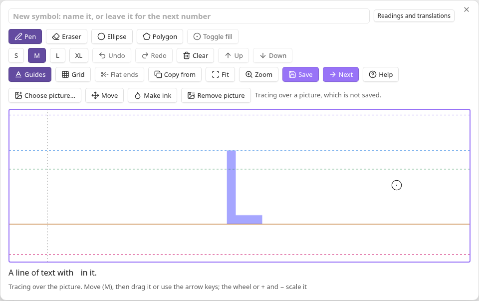

# Drawing in the editor

The editor opens over the note for a new symbol, from **Inkline: Insert
symbol**, or for one you have, from **Edit symbol**. Its parts, from the top:

- the **name field**, which holds the symbol's name, and, beside it, its
  [readings and translations](#readings-and-translations);
- the **toolbar**, whose buttons show an icon, a name, or both, as **Editor
  buttons** in the [settings](./settings.md) chooses, with each tool's shortcut
  in its tooltip;
- the **picture bar**, for a picture you trace over;
- the **drawing area**, one line of text tall, with its guides;
- a **line of text** that shows the symbol at its real size as you draw;
- a **status line**, which says what the editor did last, such as "Saved".

In the shortcuts below, Mod is Ctrl, or Cmd on macOS. Single-key shortcuts and
undo give way to a text field that has the focus, such as the name field, so
that typing a name never switches tools; press Enter in the field to go back to
drawing. [Keyboard and accessibility](./keyboard.md) lists every key.

## Pen and eraser

**Pen** (P) draws; **Eraser** (E) takes ink away. Draw with a mouse or a
trackpad: every stroke is as wide as the brush. Only the main button draws, and
only one pointer at a time. A drawing tablet's pen or a touchscreen draws as a
mouse does, without pressure; Inkline does not support them otherwise.

The four **brush sizes**, S, M, L, and XL (keys 1 to 4), scale with the text and
serve both Pen and Eraser. M draws about as thick as the letters of regular
text, L near bold text, and XL heavier still; S is about half as thick as
regular text, for fine detail. Fonts differ, so the match is close rather than
exact.

A circle shows the brush's diameter, scaled with the drawing area. Pen and
Eraser keep separate sizes while the editor is open and through **Next**. A
separately opened editor starts both tools at the configured default size.

The brush circle and centre dot change between black and white to contrast with
the drawing underneath, including tracing pictures. The thin outline keeps its
shape and thickness as you move across light and dark areas. It changes size
with the brush, drawing area, zoom and display scaling. Moving a tracing picture
uses the grab cursor. Neither the circle nor dot is part of the preview or saved
symbol. If the host cannot draw the indicator or read its background, a
crosshair remains visible instead.

## Undo, redo, and clear

**Undo** (Mod+Z) and **Redo** (Mod+Shift+Z, or Mod+Y) step through every stroke,
clearing, copy, and ink made from a picture. **Clear** (Delete, or Backspace)
takes away the whole drawing, and Undo brings it back.

## Ellipses and circles

**Ellipse** (O) makes dragging draw an ellipse instead of following the pointer:
drag from one corner of the box it fills to the other, and it is drawn as you
go. With the grid off, hold Shift for a circle, as wide as the box's longer
side. It draws with the pen or the eraser, whichever is chosen, at its brush
size, so the eraser takes away a ring. A shape drawn with the eraser is tinted
red until it is done, as it would show nothing where there is no ink to take
away. Press **Ellipse** again to draw freehand. **Next** keeps it on; an editor
opened afresh draws freehand.

With the grid on, nothing goes on it unless Shift is held, so each corner of the
box is on the grid only if Shift is held as you place it: the first as you
press, the second as you let go. Shift does this instead of making a circle, and
no circle is drawn. The second corner follows the pointer, and goes back to it
if you let go of Shift while dragging. An ellipse with both corners on the grid
touches its lines at its top, bottom, and sides.

For a half circle, draw the circle, then erase the half you don't want with
eraser strokes that end on the row across its middle: with the grid and **Flat
ends** on, bring them up or down to that row and hold Shift as they end, and
their ends stop flush with it.

## Polygons

**Polygon** (Y) draws a shape with straight sides and sharp corners, such as a
triangle, a rectangle, or a lightning bolt. Click where each corner goes; the
next side follows the pointer from the last corner. Click the first corner again
to close the shape, or click the last corner again, as a double-click does, or
press Enter, to leave it open. Undo (Mod+Z) takes back the last corner, and Esc
drops the shape; so does the close button, before it closes the editor, and
Clear, with the rest of the drawing. A press dragged before its release puts the
corner where it is released. The shape draws with the pen or the eraser at its
brush size; choosing another while placing it changes the whole shape. Press
**Polygon** again to draw freehand; **Next** keeps it on.

Its corners are sharp on the outer side. A very sharp corner, under about 29°,
has its point cut off square twice the stroke's width past the corner, so that
it never reaches far beyond. An open shape's ends are square, half the stroke's
width past its end corners, so that two shapes meeting at a corner make a sharp
one.

With the grid on, a corner goes on it only if Shift is held as you click it, so
one shape can have some corners on the grid and some off it. The next side shows
where a click would put the corner. A shape's ends aren't cut flat on the grid:
an open shape keeps its square ends, past the line they lie on, and **Up** and
**Down** can then sit it on the line.

A click within the brush's circle of the first or last corner counts as that
corner, or within 4 of the drawing's pixels for a smaller brush, with the grid
on or off. So does a click with Shift held that snaps to such a corner, if Shift
put it on the grid.

## Filled shapes

**Toggle fill** (B) is a switch for the shapes drawn next, not a tool to click a
shape with: it never fills what is already drawn. While it is on, Ellipse and
Polygon draw solid shapes such as ● ▲ ■ ◆: an ellipse, and a polygon closed on
its first corner. A filled shape's edges run through its corners, or round the
box dragged, without the brush's width around them, so a filled triangle drawn
on the grid sits on the line its base lies on, and the brush size makes no
difference. An open polygon and a freehand stroke are not filled. With the
eraser, a filled shape takes away its whole area, for a hole of its shape. The
button is off while drawing freehand. Turning it on or off while placing a
polygon decides for that shape, as it closes. **Next** keeps it; an editor
opened afresh does not fill.

## Straight lines and the grid

Hold Shift while drawing to make the stroke straight, from where it was when
Shift went down. **Grid** (Shift+G) shows a grid of dots, for scripts built from
straight strokes and dots.

The grid is a guide, and nothing snaps to it unless Shift is held, for every
tool. You can keep it on to judge distances and still draw freely: a click
between its dots stays where you clicked, and a stroke starts and ends where you
pressed and let go. With the grid on, holding Shift puts what you place at that
moment on the nearest dot:

- Held as you press, it puts the stroke's start on the grid. A tap stays a dot
  there.
- Pressed part way, it makes the stroke straight from where it has got to, and
  the end of that straight part follows the dots. What you drew before stays
  where it is, including the stroke's start.
- Let go part way, it leaves the straight part as it is, ending on its dot, and
  the stroke follows the pointer again from there.
- Held as you let go of the mouse button, it puts the stroke's end on the grid.
  Letting go of Shift just before the button counts as holding it, unless the
  pointer has moved since; if it has, the stroke ends where the pointer does.

Held all the way through a stroke, Shift draws a straight line from one dot to
another. With the grid off, it only makes the stroke straight, as above.

The grid is laid out on your note's font, so that a stroke can start and end on
its lines. Its rows pass through the baseline and through each font line chosen
in the [settings](./settings.md), and the space between two neighbouring lines
is divided evenly into cells as near the size of the x-height's as fits. By
default 5 cells span the x-height; **Grid size** in the settings changes that,
from 2 to 10. Above the highest line and below the lowest, rows go on evenly to
the edges of the drawing area. Columns are as far apart as the x-height's rows,
so cells there are square, and cells between other lines are close to square. No
even grid could meet every line of every font. In a font such as Inter, at the
default grid size, the cap height then lies 7 cells above the baseline.

**Flat ends** (T) stops a stroke's ends flush with a row of the grid, instead of
rounding past it, but only the ends that Shift put on the grid, and only along a
row. It is a switch, off in a new editor, and **Next** keeps it. The button is
available with the grid on, while drawing freehand.

An end that comes in at 45° or steeper stops flush with the row through it, as
the legs of an A come down to the baseline, judged over the last grid cell or
two brush widths of what you drew, whichever is longer, and leaving out the
jumps to the grid points. So a stroke drawn down to the baseline sits on it,
with nothing below to erase. One running more along the row than across it is
not cut, so a line drawn along the baseline stays whole with round ends.

A freehand end is not on a grid line, and stays round. So does a dot, and a
stroke that ends on the grid point it started on, as a closed loop has no ends
to cut. The eraser's ends are cut the same way, so erasing up to a row leaves a
straight edge there. Shapes are never cut: an ellipse has no ends, and a polygon
keeps its square ones.

The grid keeps its place through saves. A symbol keeps its strokes exactly but
not its grid, so what you placed with Shift never moves; what can change is
where your next Shift lands. On a symbol you open again, the grid lines up with
the ends you put on it with Shift, if the grid has the same rows as when you
drew them. The rare freehand end that lies exactly on a row counts as one of
them, so with very few placed ends it can pull the columns away from those. A
symbol with none lines up with the ends that share a place within a cell, and
else with the start of the first stroke.

While **Move** is on, Shift with an arrow key moves a picture to trace over by
one column of the grid.

## Guides, view, and width

**Guides** (G) shows or hides the lines at the text font's ascender, cap height,
x-height, baseline, and descender, measured from the font your vault's text
uses, and the edges the saved image will have. **Fit** (F) fits the drawing in
view; a symbol wider than the usual view opens whole.

**Up** (ArrowUp) and **Down** (ArrowDown) move the whole drawing up or down by a
pixel of the drawing, or by a grid cell's width with Shift, in Zoom the finer
grid's, so that a shape drawn against a line can sit on it. They move every
stroke and any ink made from a picture, and one Undo takes back moves made in a
row. Ink moved past the top or bottom of the drawing area stays in the drawing
and can be moved back, but it isn't in the saved image while it is out there.
While **Move** is on, the arrow keys move the picture instead, and while **Make
ink** is open they do nothing to the drawing.

**Zoom** (Z) shows the drawing twice as large, in a taller drawing area, for
fine detail; it grows no taller than a little over half the window, or than
leaves the editor's controls in view, and shows more width instead. The wheel,
or the left and right arrow keys, move along the drawing, and **Fit** centres it
while staying zoomed. **Next** keeps the zoom for the following symbol. Zooming
changes only the view: the symbol is the same size in notes, and the brushes
stay the same size against it.

The grid, though, has twice as many cells each way while zoomed, so the default
5 cells across the x-height become 10, for placing fine detail. Every point of
the usual grid stays a point of the finer one, so a drawing started in either
view lines up in the other, and zooming out puts the usual grid back where it
was, however much you drew while zoomed. A polygon being placed keeps the grid
it started on until it ends, and Shift with an arrow key moves a picture by a
column of the grid shown. **Grid size** keeps its range of 2 to 10, and saved
symbols are not affected. On a symbol you open again, the usual grid follows the
ends you placed with Shift, so after placing them mostly on points of the finer
grid alone it can lie half a cell from where it was; the finer grid passes
through them either way.

**Help** opens a built-in quick start with an explanation of each guide, the
grid, drawing, tracing, and saving. Close Help or press Esc to return to the
drawing. The horizontal guides, top to bottom, are the font's upper extent
(ascender), the top of a capital such as H (cap height), the top of a lowercase
x (x-height), the solid baseline where letters sit, and the font's lower extent
(descender). Some fonts put guides at the same height or outside the drawing
area. The vertical dashed lines mark the saved image's edges, including spacing.

Each font line has a colour of its own, from your theme: ascender purple, cap
height blue, x-height green, baseline orange, and descender pink; light themes
draw the green and orange darker, for contrast with the background. Inkline's
[settings](./settings.md) choose which lines show; **Guides** then shows or
hides those together. A CSS snippet can change a line's colour by setting
`--inkline-guide-ascender`, `--inkline-guide-cap-height`,
`--inkline-guide-x-height`, `--inkline-guide-baseline` or
`--inkline-guide-descender` on `body .inkline-surface`, for example
`body .inkline-surface { --inkline-guide-baseline: crimson; }`.

A symbol is as wide as its ink: saving crops the image to the ink, with a little
space on each side, as a font spaces its letters. Its height is always one line
of text.

## Trace over a picture

Paste a picture with Mod+V, drop one on the editor, or open one with **Choose
picture…**, such as a screenshot of a symbol in a game, or an image from
Obsidian's file explorer. Choose picture… opens your system's file dialog, which
reaches files in the vault and outside it. It shows faintly under the drawing,
as tall as a capital letter, for you to draw over. It is never saved, nor kept
in drafts.

**Move** (M) lets you drag the picture and scale it with the wheel; the arrow
keys move it, and + and − scale it, from the keyboard. Press M again to draw.
**Remove picture** takes it away, and another paste replaces it. **Next** takes
the picture on to the next symbol where it was, so that you can trace a whole
inscription from one screenshot.

## Make ink of a picture

**Make ink** (I) turns the picture into the symbol's ink, so that a symbol you
can see needs no drawing at all. A slider sets the threshold between ink and
ground, and the drawing area previews the result; **Light ink** takes a light
symbol on a dark or transparent ground. **Apply** makes the ink, and **Cancel**
makes none.

Only what the drawing area shows becomes ink, across and within the line's
height, so that the other symbols of a screenshot stay out: move and scale the
picture first. The ink is the symbol's base layer, under its strokes: it takes
the place of any base layer the symbol had, such as ink an earlier Make ink
gave, and Undo takes it back. Saving while the preview shows makes that ink
first.

A picture shown larger than its own pixels, such as a small screenshot scaled up
to a capital's height, is sampled at the drawing's finer resolution before the
threshold applies. The ink's edges stay sharp instead of spreading across each
enlarged pixel. Where that would take too many samples, as for a large picture
enlarged across a wide drawing, it is sampled less finely, down to its own
pixels. A picture with transparency keeps the soft edges of its own transparency
when enlarged; see [Limits](./limits.md#files-and-sizes).

A dim picture, such as a dark screenshot of a game, gets edges as sharp as a
bright one's. The ink's edge narrows with the contrast between the two sides of
the threshold, instead of being as soft as the picture's own edges on a picture
with little contrast. A few bright pixels elsewhere in the picture do not change
it, but they can draw the threshold's first position to them: move the slider
down to the strokes, or move the picture to keep those pixels out. Soft strokes
come out wider than they were drawn; see [Limits](./limits.md#files-and-sizes).

## Start from a copy

In the editor for a new symbol, **Copy from** (V) starts it from a copy of
another symbol's strokes and ink, chosen from a list of the vault's symbols with
their pictures, in place of what is drawn so far, for scripts whose symbols
share parts. Undo takes the copy back.

A large symbol takes a moment to read, and a notice says so. What you draw
meanwhile stays in the history, for Undo to bring back. If a save or a question
comes up before the symbol is read, the drawing stays as it is, and the status
line says that it was not copied, so that **Save** cannot save the copy in your
drawing's stead. Choose it again.

The list finds a symbol by its
[readings and translations](#readings-and-translations) as well as its path, and
a row found that way says so. The copy takes only the drawing: they stay with
the symbol they were written for, and the status line says so. A variant is
another symbol, which may be read differently, and a copied guess would go on
being found after the original was corrected.

## Save

- **Save** (Mod+Enter) saves and closes the editor. For a new symbol, the first
  save creates the file and inserts its embed.
- Mod+S saves and keeps the editor open.
- **Next** (Mod+Shift+Enter), for a new symbol, saves and inserts it, then opens
  a blank editor for the symbol that follows it.

Saving an edited symbol updates its existing placements in open notes and popout
windows, in both text-colour and stored-grey modes. Notes keep their text and
any explicit image sizes; they do not need to be reopened. When your notes use
the symbol more than once, the first save of a changed drawing asks whether to
**Replace** it everywhere first;
[Changing a symbol used elsewhere](./recovery.md#changing-a-symbol-used-elsewhere)
describes the question, and how to make a variant instead.

A save that fails keeps the editor open with the drawing and says why. Closing
with unsaved changes, by Esc, the close button, or a click outside, asks whether
to save, discard them, or keep drawing; [Saving and recovery](./recovery.md)
describes the rest.

## The name

The name field is the symbol's file name without `.ink.png`. A name can use any
script, and emoji, with the joiners and marks they need. A name is refused, with
a notice, when its folder already has a symbol of that name in any letter case,
when Windows reserves it, such as `CON`, or when it is too long for a file name.
Characters that a file name cannot hold on some system, or that would break a
link, such as `/ \ : * ? " < > | # ^ [ ]`, are left out, as are invisible spaces
and the controls that reorder text.

Changing the name of a symbol that has a file renames the file when you save,
through Obsidian, so that the links to it follow as Obsidian's settings say. If
the rename fails, the drawing is saved anyway, and the editor stays open with
the name for the next save to try.

A rename first saves every open note that holds unsaved text, as Obsidian writes
links at places it noted before it asks about them. If a note cannot be saved,
nothing is renamed, and the editor stays open with the name for the next save to
try. A new symbol's embed takes the new name whatever you answer Obsidian, and
the cursor stays just after the symbol.

**Unreleased:** the symbol's file is checked again once the drawing and the
notes are saved, just before Obsidian renames it. If it was deleted and
replaced, or renamed elsewhere, meanwhile, or another symbol took the new name,
nothing is renamed: the drawing is saved, a notice says why, and the editor
stays open with the name you typed for the next save to try. A name given
elsewhere stays until then.

## Readings and translations

The button beside the name shows a symbol's readings and translations, and opens
two fields to fill them in. It adds no row to the editor, and a symbol that has
some shows them on the button. A field holds one value to a line, the main one
first, so press Enter between two values. Tab moves on from a field, and
Mod+Enter saves as it does anywhere in the editor.

They save with the symbol, on the same **Save** as the drawing, and a draft
keeps what you typed as it keeps a new name. Spaces around a value and blank
lines are left out. A list over 4,096 bytes can't be saved: the field says so,
and nothing is written until it is shorter. With **Next**, the fields stay open
and the next symbol starts with them empty.

[Symbols in notes](./notes.md#readings-and-translations) says what they are for,
and the library changes them without opening the editor.
