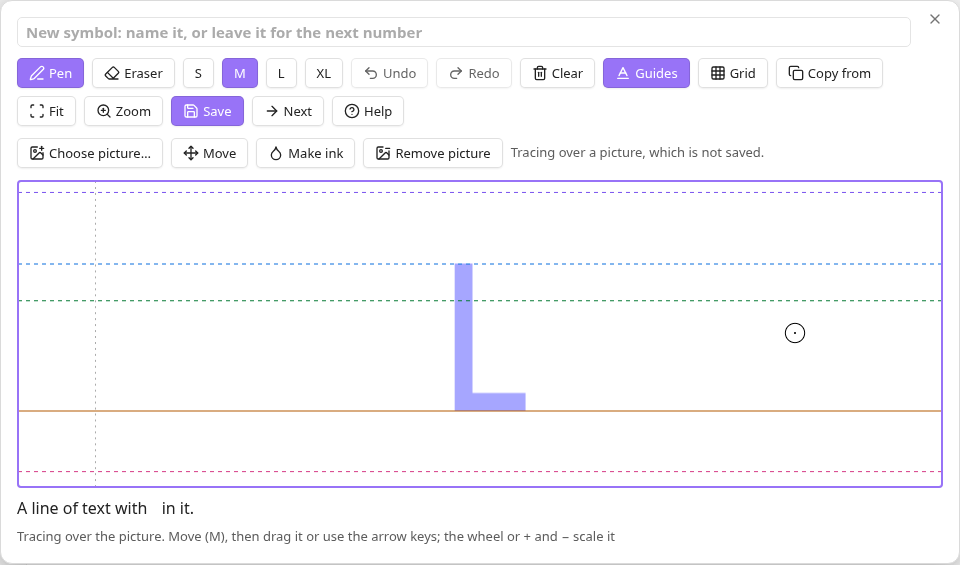

# Drawing in the editor

The editor opens over the note for a new symbol, from **Inkline: Insert
symbol**, or for one you have, from **Edit symbol**. Its parts, from the top:

- the **name field**, which holds the symbol's name;
- the **toolbar**, whose buttons show an icon, a name, or both, as **Editor
  buttons** in the [settings](./settings.md) chooses, with each tool's shortcut
  in its tooltip;
- the **picture bar**, for a picture you trace over;
- the **drawing area**, one line of text tall, with its guides;
- a **line of text** that shows the symbol at its real size as you draw;
- a **status line**, which says what the editor did last, such as "Saved".

In the shortcuts below, Mod is Ctrl, or Cmd on macOS. Single-key shortcuts and
undo give way to a text field that has the focus, such as the name field, so
that typing a name never switches tools; press Enter in the field to go back to
drawing. [Keyboard and accessibility](./keyboard.md) lists every key.

## Pen and eraser

**Pen** (P) draws; **Eraser** (E) takes ink away. Draw with a mouse or a
trackpad: every stroke is as wide as the brush. Only the main button draws, and
only one pointer at a time. A drawing tablet's pen or a touchscreen draws as a
mouse does, without pressure; Inkline does not support them otherwise.

The four **brush sizes**, S, M, L, and XL (keys 1 to 4), scale with the text and
serve both Pen and Eraser. M draws about as thick as the letters of regular
text, L near bold text, and XL heavier still; S is about half as thick as
regular text, for fine detail. Fonts differ, so the match is close rather than
exact.

A circle shows the brush's diameter, scaled with the drawing area. Pen and
Eraser keep separate sizes while the editor is open and through **Next**. A
separately opened editor starts both tools at the configured default size.

The brush circle and centre dot change between black and white to contrast with
the drawing underneath, including tracing pictures. The thin outline keeps its
shape and thickness as you move across light and dark areas. It changes size
with the brush, drawing area, zoom and display scaling. Moving a tracing picture
uses the grab cursor. Neither the circle nor dot is part of the preview or saved
symbol. If the host cannot draw the indicator or read its background, a
crosshair remains visible instead.

## Undo, redo, and clear

**Undo** (Mod+Z) and **Redo** (Mod+Shift+Z, or Mod+Y) step through every stroke,
clearing, copy, and ink made from a picture. **Clear** (Delete, or Backspace)
takes away the whole drawing, and Undo brings it back.

## Straight lines and the grid

Hold Shift while drawing to make the stroke straight, from where it was when
Shift went down. **Grid** (Shift+G) shows a grid of dots and snaps the ends of
strokes to them, for scripts built from straight strokes and dots; a tap on the
grid stays a dot.

The grid is laid out on your note's font, so that a stroke can start and end on
its lines. Its rows pass through the baseline and through each font line chosen
in the [settings](./settings.md), and the space between two neighbouring lines
is divided evenly into cells as near the size of the x-height's as fits. By
default 5 cells span the x-height; **Grid size** in the settings changes that,
from 2 to 10. Above the highest line and below the lowest, rows go on evenly to
the edges of the drawing area. Columns are as far apart as the x-height's rows,
so cells there are square, and cells between other lines are close to square. No
even grid could meet every line of every font. In a font such as Inter, at the
default grid size, the cap height then lies 7 cells above the baseline.

On the grid, a stroke's ends stop flush with the grid line they lie on, instead
of rounding past it: the line across the stroke, a row for a stroke that comes
in at 45° or steeper, as the legs of an A come down to the baseline, and a
column for a flatter one. So a stroke drawn down to the baseline sits on it,
with nothing below to erase. A dot stays round, as does an end drawn with the
grid off. The eraser's ends are cut the same way, so erasing up to a line leaves
a straight edge there.

The grid keeps its place through saves, and on a symbol you open again it lines
up with most of its strokes, if the grid has the same size as when you drew
them. While **Move** is on, Shift with an arrow key moves a picture to trace
over by one column of the grid.

## Guides, view, and width

**Guides** (G) shows or hides the lines at the text font's ascender, cap height,
x-height, baseline, and descender, measured from the font your vault's text
uses, and the edges the saved image will have. **Fit** (F) fits the drawing in
view; a symbol wider than the usual view opens whole.

**Zoom** (Z) shows the drawing twice as large, in a taller drawing area, for
fine detail; it grows no taller than a little over half the window, and shows
more width instead. The wheel, or the left and right arrow keys, move along the
drawing, and **Fit** centres it while staying zoomed. **Next** keeps the zoom
for the following symbol. Zooming changes only the view: the symbol is the same
size in notes, and the grid and brushes stay the same size against it.

**Help** opens a built-in quick start with an explanation of each guide, the
grid, drawing, tracing, and saving. Close Help or press Esc to return to the
drawing. The horizontal guides, top to bottom, are the font's upper extent
(ascender), the top of a capital such as H (cap height), the top of a lowercase
x (x-height), the solid baseline where letters sit, and the font's lower extent
(descender). Some fonts put guides at the same height or outside the drawing
area. The vertical dashed lines mark the saved image's edges, including spacing.

Each font line has a colour of its own, from your theme: ascender purple, cap
height blue, x-height green, baseline orange, and descender pink; light themes
draw the green and orange darker, for contrast with the background. Inkline's
[settings](./settings.md) choose which lines show; **Guides** then shows or
hides those together. A CSS snippet can change a line's colour by setting
`--inkline-guide-ascender`, `--inkline-guide-cap-height`,
`--inkline-guide-x-height`, `--inkline-guide-baseline` or
`--inkline-guide-descender` on `body .inkline-surface`, for example
`body .inkline-surface { --inkline-guide-baseline: crimson; }`.

A symbol is as wide as its ink: saving crops the image to the ink, with a little
space on each side, as a font spaces its letters. Its height is always one line
of text.

## Trace over a picture

Paste a picture with Mod+V, drop one on the editor, or open one with **Choose
picture…**, such as a screenshot of a symbol in a game, or an image from
Obsidian's file explorer. Choose picture… opens your system's file dialog, which
reaches files in the vault and outside it. It shows faintly under the drawing,
as tall as a capital letter, for you to draw over. It is never saved, nor kept
in drafts.

**Move** (M) lets you drag the picture and scale it with the wheel; the arrow
keys move it, and + and − scale it, from the keyboard. Press M again to draw.
**Remove picture** takes it away, and another paste replaces it. **Next** takes
the picture on to the next symbol where it was, so that you can trace a whole
inscription from one screenshot.

## Make ink of a picture

**Make ink** (I) turns the picture into the symbol's ink, so that a symbol you
can see needs no drawing at all. A slider sets the threshold between ink and
ground, and the drawing area previews the result; **Light ink** takes a light
symbol on a dark or transparent ground. **Apply** makes the ink, and **Cancel**
makes none.

Only what the drawing area shows becomes ink, across and within the line's
height, so that the other symbols of a screenshot stay out: move and scale the
picture first. The ink is the symbol's base layer, under its strokes: it takes
the place of any base layer the symbol had, such as ink an earlier Make ink
gave, and Undo takes it back. Saving while the preview shows makes that ink
first.

A picture shown larger than its own pixels, such as a small screenshot scaled up
to a capital's height, is sampled at the drawing's finer resolution before the
threshold applies. The ink's edges stay sharp instead of spreading across each
enlarged pixel. Where that would take too many samples, as for a large picture
enlarged across a wide drawing, it is sampled less finely, down to its own
pixels. A picture with transparency keeps the soft edges of its own transparency
when enlarged; see [Limits](./limits.md#files-and-sizes).

## Start from a copy

In the editor for a new symbol, **Copy from** (V) starts it from a copy of
another symbol's strokes and ink, chosen from the vault's symbols, in place of
what is drawn so far, for scripts whose symbols share parts. Undo takes the copy
back.

## Save

- **Save** (Mod+Enter) saves and closes the editor. For a new symbol, the first
  save creates the file and inserts its embed.
- Mod+S saves and keeps the editor open.
- **Next** (Mod+Shift+Enter), for a new symbol, saves and inserts it, then opens
  a blank editor for the symbol that follows it.

Saving an edited symbol updates its existing placements in open notes and popout
windows, in both text-colour and stored-grey modes. Notes keep their text and
any explicit image sizes; they do not need to be reopened. When your notes use
the symbol more than once, the first save of a changed drawing asks whether to
**Replace** it everywhere first;
[Changing a symbol used elsewhere](./recovery.md#changing-a-symbol-used-elsewhere)
describes the question, and how to make a variant instead.

A save that fails keeps the editor open with the drawing and says why. Closing
with unsaved changes, by Esc, the close button, or a click outside, asks whether
to save, discard them, or keep drawing; [Saving and recovery](./recovery.md)
describes the rest.

## The name

The name field is the symbol's file name without `.ink.png`. A name can use any
script, and emoji, with the joiners and marks they need. A name is refused, with
a notice, when its folder already has a symbol of that name in any letter case,
when Windows reserves it, such as `CON`, or when it is too long for a file name.
Characters that a file name cannot hold on some system, or that would break a
link, such as `/ \ : * ? " < > | # ^ [ ]`, are left out, as are invisible spaces
and the controls that reorder text.

Changing the name of a symbol that has a file renames the file when you save,
through Obsidian, so that the links to it follow as Obsidian's settings say. If
the rename fails, the drawing is saved anyway, and the editor stays open with
the name for the next save to try.
