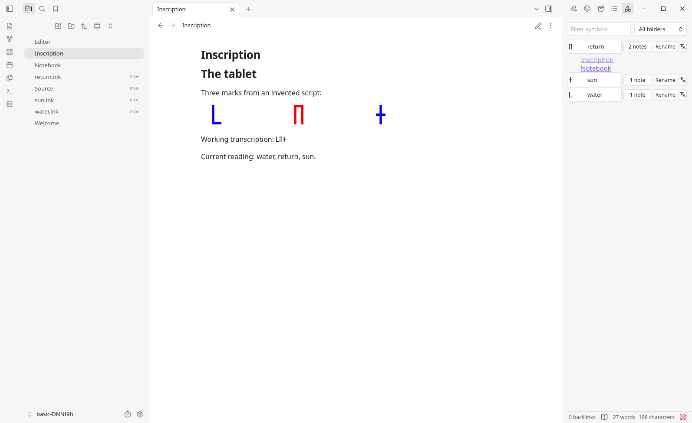

::: info Prerelease

Inkline is a prerelease for Obsidian 1.13.4 or later, on desktop.
[Install the release ZIP](./install.md), then draw your first symbol.

:::

## What it is for

Inkline is for writing notes in a script that no font has, so you cannot type
it. That is the same work from two directions:

- **Working a script out.** Some games, such as Chants of Sennaar, have an
  invented language, and working it out is the game. You draw the symbols that
  someone else made.
- **Making a script up.** A constructed language (a conlang) can have a script
  of its own. You draw the symbols that you make.

Either way, Inkline does two things:

- **Write a symbol down easily.** Draw it where you need it, or trace it from a
  picture, and it sits in the line like a letter.
- **Use it again easily.** A symbol has a name, and can record how it is read
  and what it means. Type the insert trigger, `;;` unless you change it in the
  settings, and a few letters of any of them to write the symbol again in any
  note. Its readings and translations can be edited at any time without changing
  a note, and the library finds every note that uses it.

A cipher or a personal shorthand works the same way.

It is not a whiteboard, a handwriting notebook, a font editor, or a set of
ready-made symbols: it draws small symbols of your own, one at a time, for use
in text.

## What it does now

- **Draw** a symbol in an editor sized to one line of text, with a mouse or a
  trackpad, with guides at the text font's lines; trace over a screenshot, or
  turn it into ink, instead of drawing. See
  [Drawing in the editor](./drawing.md).
- **Insert** it where you were writing, or type the insert trigger and a few
  letters of a symbol you have to insert it again. See
  [Symbols in notes](./notes.md).
- **Name** and rename it in its editor, and **edit** it again from its menu, a
  command, or the file explorer.
- **Record** how it is read and what it means, apart from its name, and find it
  by either. See
  [Readings and translations](./notes.md#readings-and-translations).
- **Find and reuse** your symbols in the sidebar library, with a filter,
  folders, and the notes that use each. See
  [Find where a symbol is used](./notes.md#find-where-a-symbol-is-used).
- **Keep your work**: the editor asks before closing unsaved work, keeps unsaved
  strokes as a draft after a crash, and never saves over a file it cannot read.
  See [Saving and recovery](./recovery.md).

[Settings](./settings.md) describes size, colour, insertion, and drawing
preferences; [Known limits](./limits.md) lists what else is missing.

## Who maintains it

Inkline is written and maintained by AI agents, and no person reviews the code.
Its source, issues, and change history are on
[GitHub](https://github.com/viell-dev/slop-inkline).
