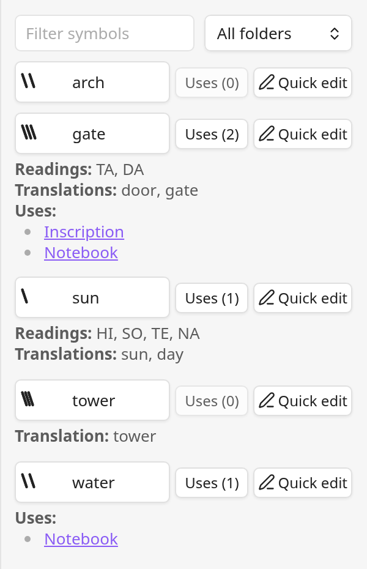
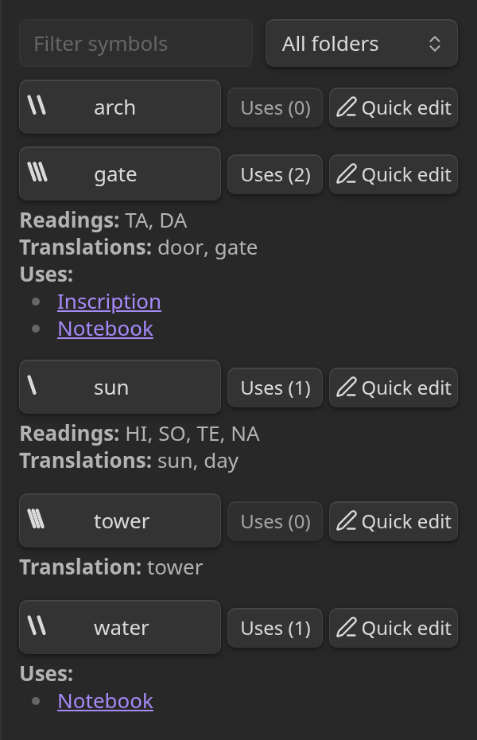
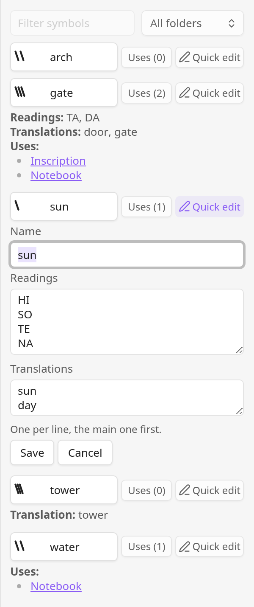
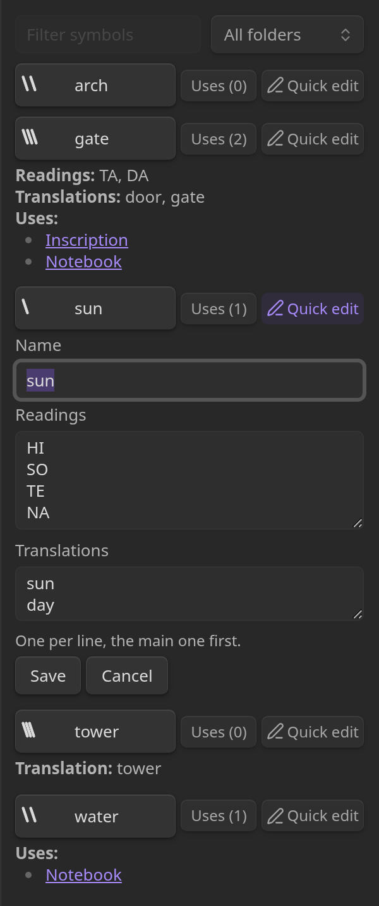

# Symbols in notes

A symbol in a note is an ordinary image embed of its file, such as
`![[tower.ink.png]]`, which Inkline shows as a character of the text. Inkline
knows a symbol by its file name, which ends in `.ink.png`.

## How symbols show

By default, a symbol is as tall as a line of text, 1.5 times the text's size,
which is Obsidian's default line height, and stands on the baseline like a
letter. It takes the colour of the text around it, in light and dark themes, and
grows with headings and zoom. A line set tighter than that, such as a heading,
grows to fit it.

[Settings](./settings.md) changes the size relative to the text and chooses
whether ink takes the text's colour or shows its stored grey pixels.

This holds in Live Preview, Reading view, callouts, tables, embedded notes,
hover previews, text cards on a canvas, and popout windows.

- A symbol stands on the baseline wherever it falls in the line, and the symbols
  of a line line up with each other. In Obsidian's default 16-pixel text it
  stands exactly on the letters' baseline. At some text sizes, Symbol sizes, and
  zoom levels it stands off the letters, by up to about a pixel at 100% zoom and
  up to about two at other zoom levels, as
  [Known limits](./limits.md#in-general) says.
- **An explicit size** that Obsidian's embed syntax gives, as in
  `![[tower.ink.png|24]]`, is kept, and the symbol still stands on the baseline.
  So does a size wider than the space the symbol is in, which Obsidian shrinks
  evenly to fit.
- A symbol wider than the space it is in, as a very wide one can be in a hover
  preview, a table cell, a narrow pane, or a PDF page, shrinks evenly to fit,
  whole and on the baseline, rather than being squeezed sideways. It still takes
  the whole width of that space, so in Live Preview a click beside its ink on
  that line selects the symbol.
- **Hovering** a symbol shows its name, or what its embed's alias or alt text
  says; screen readers read it too.
- **A symbol file shown on its own**, in its own tab or as an image on a canvas,
  stays a picture, as do images from outside the vault and every other image.
- In Live Preview, Obsidian's resize handle and image buttons do not cover a
  symbol.

## Insert a new symbol

Run **Inkline: Insert symbol** in a note in editing view, draw the symbol, and
save it, as [Your first symbol](./start.md) shows. The first save creates the
file in the [symbol folder](./settings.md), or where Obsidian puts the note's
new attachments, under the name you typed or the next free number in that
folder, and inserts the embed, written as your vault writes links.

The embed goes where the cursor was when you ran the command:

- into the note the editor was started in, even if that note's tab shows another
  note by then or was closed;
- where the text around that place now is, if the note changed while you drew,
  as by sync or another pane; if that place cannot be found, at the end of the
  note, with a notice that says so;
- just after a link, an embed, or a web address the cursor was in, so that no
  link is split. After a bare web address, which only a space ends, a space
  comes first;
- **Unreleased:** nowhere, if the note was deleted while you drew, as by sync or
  on another device. The symbol is saved without its embed, a notice says so,
  and the editor closes as after any save, without opening another for **Next**.
  Insert the symbol where you want it as
  [a symbol you have](#insert-a-symbol-you-have).

The cursor then lands just after the symbol, as after a typed character, so you
can type on at once, in a table cell in Live Preview too. Text you had selected
stays as it was. With **Next**, each symbol goes after the one before, in the
order you drew them, and the cursor ends after the last, also when you discard
the drawing you were on. A note that has gone to Reading view meanwhile takes
the symbol too, through its file, which keeps its line endings, Windows ones
included.

## Insert a symbol you have

Type the insert trigger, `;;` unless you changed it in the
[settings](./settings.md), and a few letters of a symbol's name, or of one of
its [readings and translations](#readings-and-translations), in any script, to
list the matching symbols with their pictures:

1. The list puts the best match first, then the symbols this note uses most,
   then the most recently changed, and shows up to 50.
2. Enter, or a click, puts the chosen symbol's embed in place of what you typed.
3. Esc closes the list, and what you type after it stays text.

Typed with a space, the name must hold what you typed, so that a sentence typed
on after the trigger stops matching. The trigger in code, inline or fenced, and
in front matter lists nothing: it is the note's own text there.

Code is where Reading view shows it. Inline code can run on from an earlier line
of its paragraph, which the editor may not show as code, and the trigger lists
nothing there either, nor in a code block made by indenting lines four spaces or
a tab. A fenced code block in a quote or a list item ends with the quote or the
item, even if it is never closed, so the trigger in the text after it lists
again. A callout's title line is read on its own: inline code in it ends with
the line.

Inline code starts and ends where Reading view finds it. A backtick inside a
wiki link, a link's address, a `%%` comment, math, a web address, or an HTML tag
starts no inline code. Inline code can sit inside emphasis, strikethrough, a
highlight, a link's text, or square brackets, and ends where they do: in
`` **`a** b` `` nothing is code, while in ``**`code`**`` the word is. A tab
after a quote's `>`, or after a list item's marker and a space, makes the line
indented code, unless it goes on in a paragraph. A line without `>` stays in its
quote after any block in it, unless it starts a block that ends the quote, such
as a heading or a list item. The trigger also lists nothing in a block of HTML,
where an embed shows as text, nor in a paragraph too long to read in time, such
as one of a thousand brackets that nothing closes. After a `<code>` or `<pre>`
tag, in any form, `<code/>` included, the trigger lists nothing until the note
closes it with `</code>` or `</pre>`, over blank lines and other blocks too: the
list stays closed in all the text between, even where Reading view shows some of
it as ordinary text. A closing tag counts only where the browser reads it as
one: not inside an HTML comment, a quoted attribute, a `<textarea>` or
`<style>`, a table's cell, or a footnote, and not past eight or more nested
blocks. The trigger lists nothing inside an HTML tag or comment, a `%%` comment,
or inline math either, where an embed shows nothing, nor in the text of a
`<textarea>` or the like. After a comment, tag, or quote that a block of HTML
leaves open, and after a `<script>`, an `<svg>`, or a `<math>`, the trigger
lists nothing in the rest of the note. A few rare notes are still read
otherwise, as [#271](https://github.com/viell-dev/slop-inkline/issues/271)
lists.

**Inkline: Insert existing symbol** opens the same list as a search, and inserts
the chosen symbol at the cursor. It places the symbol as **Inkline: Insert
symbol** does: just after a link or embed the cursor is inside, so that no link
is split, and beside selected text, which stays. If the note changes while the
search is open, the symbol still goes where the cursor was.

Both find a symbol by a reading or translation whatever its name: with the
default trigger, `;;TA` lists a symbol with the reading `TA`, and a row found
that way says so, under its name, as in `Reading: TA`. A value must hold what
you typed, in any letter case, and with or without its accents; a name still
matches loosely. The best match comes first, name or value, and of the two, the
name.

An accent is a mark on the letters of the Latin or Greek alphabet, or a stress
mark in Cyrillic: `sa` finds `šá`, and typing `šá` asks for those accents. Any
other mark makes another sound, so it counts as part of its letter: `は` does
not find `ば` or `ぱ`, nor `и` find `й`, nor `क` find `कि`, and the vowel points
of Arabic and Hebrew have to be typed to find a value that has them. Korean goes
by its spelling, so `가` finds `각`, which starts with it.

These lists, [Copy from](./drawing.md#start-from-a-copy), and the library give
each picture a column of its own, so that names line up whatever each symbol's
width. A symbol wider than the column shows whole, at a smaller size. In a
right-to-left interface, which Obsidian mirrors, the column is at the right of
the name, and each picture starts at the column's right.

## Edit a symbol

**Edit symbol** opens a symbol in the editor again, with every stroke as drawn.
It is offered:

- in a symbol file's menu, in the file explorer and on its tab;
- in Live Preview, in Obsidian's menu for the symbol's picture, on right-click;
- in Reading view, embedded notes, and popout windows, in the menu Inkline shows
  on right-click on a symbol, where Obsidian would open its image viewer;
- in the editor's menu on an embed's text;
- in a symbol's menu in the library;
- as the command **Inkline: Edit symbol**, with the cursor on a symbol's embed,
  outside code and front matter.

Double-clicking a symbol opens it in the editor as well, where the second click
reaches the symbol:

- in Live Preview, a table in it included, and in popout windows;
- on a canvas, in a card or a note that is not focused, and in a text card's own
  editor.

The first click does what it did before, such as selecting the picture or
focusing the card, and neither Obsidian's image viewer nor the card's text
opens. A double-click on any other picture, or on words, does what Obsidian does
with it. In Reading view, embedded notes, hover previews, and a focused canvas
card, a click on a picture opens Obsidian's image viewer, and in a callout in
Live Preview a click shows the callout as text, so the second click lands
elsewhere. There, right-click the symbol for **Edit symbol**.

A symbol with a large base layer takes a moment to open, and a notice says so.
Obsidian goes on answering meanwhile, so a key you press still reaches the note
until the editor is there. Asking for the same symbol again changes nothing, and
asking for another opens that one instead. If another window opens meanwhile,
such as the command palette, the symbol does not come up over it, and a notice
says to open it again. If you choose **Reload** in the editor and go on drawing
or typing while it reads the file, it asks again.

A symbol saved by a version before 0.9.2 opens as a
[picture to draw over](./recovery.md#pictures-without-strokes), without its
strokes, and the editor says why.

Right-clicking a symbol offers Edit symbol wherever else the symbol is:

- in a callout or a table in Live Preview, in Obsidian's menu for the block,
  beside its own items;
- on a canvas, in the canvas's menu for a text card or a note that is not
  focused, or for several selected cards, beside its own items;
- in a focused card on a canvas, in the menu Inkline shows, where Obsidian would
  open its image viewer. That menu takes the place of the card's, so right-click
  beside the symbol for the card's menu;
- in a canvas text card's own editor, in the same menus as in a note. The
  command **Inkline: Edit symbol** works there too.

Right-clicking anywhere else in a block shows its menu as before.

Saving the edited symbol changes it in every note that shows it. When your notes
use it more than once, the first save of a changed drawing asks first whether to
replace it everywhere;
[Saving and recovery](./recovery.md#changing-a-symbol-used-elsewhere) describes
the question, and how to make a variant instead.

## Names and renames

A symbol's name is its file's name, and can be anything that suits you. How it
is read and what it means go in its
[readings and translations](#readings-and-translations). Rename a symbol in
[its editor](./drawing.md#the-name) or in
[the library](#find-where-a-symbol-is-used).

## Readings and translations

A symbol can record how it is read and what it means, apart from its name. A
**reading** is how it is read aloud, written any way you like: the sign た might
have the reading `TA`. A **translation** is what it means, in words of any
language. Either can hold several values, one to a line, the main one first. The
two lists are separate, so the second reading has nothing to do with the second
translation.

The name stays what your notes link to, so editing a symbol's readings and
translations changes no note and needs no rename, and a symbol can be named
anything while they still find it. A name and a reading that disagree are not a
fault: Inkline never fills one in from the other or keeps them in step, and
renaming a symbol leaves its readings as they are.

- Fill them in while drawing, from
  [beside the name in the editor](./drawing.md#readings-and-translations).
- Change them without opening the editor, from the
  [library](#find-where-a-symbol-is-used). This works on a file the editor will
  not open, such as one whose strokes are damaged.
- Find a symbol by them in
  [the insert trigger's list](#insert-a-symbol-you-have), **Inkline: Insert
  existing symbol**, [Copy from](./drawing.md#start-from-a-copy), and the
  library's filter.

The values live in the file, in PNG text chunks that other programs can read, so
they go with a copy of it. Some programs drop them; see
[Without Inkline](./without-inkline.md#editing-them-elsewhere).

## Find where a symbol is used

Run **Inkline: Show symbol library** to open **Symbols** in the right sidebar.
It lists every symbol with its picture, name, folder, and how many notes link to
it. Each note counts once, however often it uses the symbol. Symbols are ordered
by folder, the top folder first, then by name, with numbers in order.

- Type part of a name, a reading, or a translation in **Filter symbols**, in any
  letter case or script, and choose a folder to narrow the list.
- Click a symbol to insert it at the cursor in the note you were last in. The
  cursor moves after it and the library keeps the focus, so successive clicks
  write successive symbols. A selection's text is kept; a cursor inside a link
  or embed puts the symbol just after it. Open a note in editing view first; a
  note in Reading view cannot take an insertion.
- Click **Uses (2)**, which counts the notes that use a symbol, to list them,
  then click a note to open it. Ctrl-click, or Cmd-click on macOS, opens a new
  tab.
- Right-click a symbol for its file's menu, including **Edit symbol**.
- Choose **Quick edit** beside a symbol to edit its name, readings, and
  translations in that row, as [Quick edit](#quick-edit) describes.

A row keeps its picture, name, and buttons on one line in the default sidebar. A
long name wraps onto a second line and then shortens, and a long folder
shortens, rather than running off the sidebar. Hold the pointer over the symbol
for its whole name and folder. **Quick edit** also shows the whole name, without
the pointer. In a sidebar too narrow for the name and the buttons, the buttons
drop below the name.

A symbol's [readings and translations](#readings-and-translations) show under
its row, a line for each, which a long list shortens. They start at the row's
edge, at the size of Quick edit's labels, with **Readings:** and
**Translations:** in bold, and have a little more space above and below them, so
that they read as part of their row; a symbol with none keeps a row of the usual
height. The notes that **Uses** lists follow them as part of the same list,
under a bold **Uses:**, one to a line with a bullet.

- A row the filter found by a value shows it first, in bold, so a match with
  another name is no mystery. While Inkline is still reading the vault's
  symbols, as it does for a few seconds after Obsidian starts in a vault of
  thousands of them, a line says that more may match.
- The list draws 100 symbols at a time, so that typing in the filter stays
  quick. **Show more** adds the next 100.

If a name is refused or a rename fails, the entered name stays for correction or
retry. Save or cancel it before filtering again; the list then catches up with
any files and links that changed while you typed. Renaming changes the file's
name, leaving its drawing's bytes as they are. A symbol deleted and replaced
while its name is being edited cannot rename the replacement.

A rename first saves every open note that holds unsaved text, as
[renaming in the editor](./drawing.md#the-name) does. If a note cannot be saved,
the row says which one, and nothing is renamed.

Saving the notes can take a moment on a slow disk, and Obsidian makes a rename
wait while it indexes notes, such as those just saved, or finishes another
rename. The symbol is checked again once both are done, and Obsidian begins to
move it in that same step. A symbol deleted and replaced meanwhile, or renamed
elsewhere, is not renamed, and nor is one whose new name another symbol has
taken meanwhile. The row says why and keeps the name you typed, and **Save**
tries again, from the name the symbol has now. A symbol renamed elsewhere keeps
the links that rename left: Obsidian's file explorer updates them as its
settings say, but a rename by sync or another app leaves notes embedding the old
name. A change that reaches the file at the very moment Obsidian moves it, such
as one by another app, is not refused but reported: the row says what happened
and where the symbol is, as
[the limits](./limits.md#a-file-changed-as-obsidian-renames-it) describe.

A rename can take a while in a much used symbol, as Obsidian updates each note
that links to it, and for as long as you take over any rename's question about
links. Neither is a problem, and the row says nothing of them. If it stops, as
on a drive that stops answering, the row says so after a few seconds, and
**Cancel** or Esc close it; see
[what is kept](./limits.md#a-file-written-at-the-moment-inkline-saves).

The list follows files and their links as they change. Obsidian's backlinks for
the symbol file also list the notes that link to it.

Keep the library in a sidebar to insert into a note. If its tab is dragged into
the main area, return it to a sidebar before inserting.

### Quick edit

**Quick edit** beside a symbol opens its name, readings, and translations
together in its row, with the name selected and the readings and translations
one value to a line. **Save**, Enter in the name, or Ctrl+Enter, or Cmd+Enter on
macOS, in any field, saves what you changed. Esc or **Cancel** keeps everything
as it was, and Save with nothing changed only closes the row. One row is edited
at a time. An empty name keeps the old one, and the same name rules apply as in
the drawing editor. Spaces around a value and blank lines are left out.

The readings and translations fields grow and shrink with what they hold, from
two lines to eight, and scroll past that. Drag a field's corner to give it a
height of its own, which it then keeps. While a row is in Quick edit, the other
rows' **Uses** and **Quick edit** buttons, and **Show more**, are unavailable
until you save or cancel it; a click on one does nothing. Clicking a symbol
still inserts it, and a note listed under a row still opens.

One Save writes the readings and translations first, changing the file's text
and nothing else: its drawing's bytes stay as they are, and no note is touched.
It then renames the symbol through Obsidian, so that links follow according to
Obsidian's link settings. A name or a list that would be refused, such as a name
another symbol in the folder has, or a list over 4,096 bytes, is refused before
anything is written, and everything you typed stays to correct.

- If the readings and translations cannot be written, nothing is renamed. The
  row says why, and keeps the name and the text you typed.
- If the rename fails after they were written, the row says that they are saved
  and why the name is not, and keeps the name you typed: **Save** then tries
  only the name again. So it does if the symbol is renamed elsewhere, as by
  sync, while they are written: it is not renamed again, and **Save** renames it
  from the name it has then.
- A save left with **Cancel** or Esc while the readings and translations wait to
  be written renames nothing, even if they are still written. One left while the
  rename waits keeps them saved, and a notice says so. A rename that Obsidian
  has already begun can still finish, as
  [the limits](./limits.md#a-file-written-at-the-moment-inkline-saves) say.

If the file changes while its row is open, as by sync, a field you have not
typed in follows it. One you have typed in keeps your text, and a line says what
saving will replace. A name you have not changed follows a rename elsewhere, so
that saving the readings and translations keeps that name. On a file whose
readings and translations cannot be read when Quick edit opens, their fields
stay closed, and the name can still change.

## Export a note to PDF

Run Obsidian's **Export to PDF** command while the note is open, choose its
export options, and save the PDF. Symbols keep their size, baseline, and colour
preference, including explicit embed sizes. Obsidian uses its light print theme
for the exported note, even when you read it in a dark theme.

Physical printer output has not been checked; the automated checks cover native
PDF export on Linux and the resulting document's pixels and layout.

In text colour, some PDF viewers draw a faint one-pixel line along an edge of a
symbol's box at some zoom levels, Obsidian's own PDF view among them. It comes
from how the browser Obsidian is built on writes a symbol's colour into the PDF,
not from a mark in the symbol, and it was not seen when the PDF was drawn at 300
dots per inch or more. Symbols in stored colour show no such line
([#255](https://github.com/viell-dev/slop-inkline/issues/255)).
